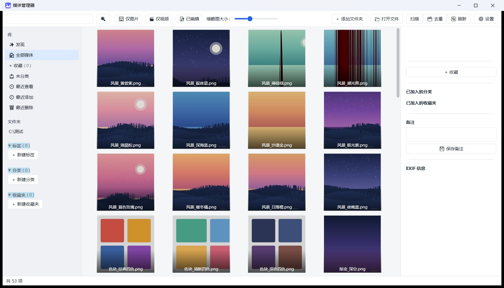
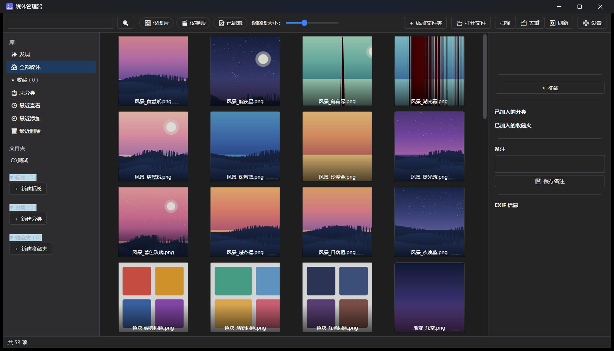

# 📸 MediaManager — 极速、纯本地的 Windows 图片/视频管理工具

> 一款免费、开源、纯本地无广告的 Windows 媒体管理工具。帮你集中浏览、整理、编辑电脑与移动硬盘里的照片和视频，数据始终掌握在自己手里。

**[📥 点击这里下载最新版安装包](https://github.com/3206YYY/MediaManager/releases)** ｜ **[☕ 赞助开发者](#sponsor)** ｜ **[🐛 提交 Bug](https://github.com/3206YYY/MediaManager/issues)**

| ☀️ 浅色模式 | 🌙 深色模式 |
|:---:|:---:|
|  |  |

---

## 🤖 开发者自白 (About the Developer)

本项目是由本人虔诚地向圣诞老人（AI）许愿得到。本人只参与了产品创意、UI 交互设计和测试，一周做完，79 项测试全过，产品仍在快速迭代，欢迎提 Issue 指出问题。

*This project is co-developed with AI. Ideas, UI/UX design, and rigorous testing are done by a human; coding is done by AI.*

---

## ✨ 为什么选择 MediaManager？

- 🚀 **极速不卡顿**：虚拟化列表 + 后台多线程解码，实测十万张图滚动丝滑，内存占用硬顶 200MB。
- 💾 **纯本地无广告**：数据全在本地 SQLite，支持深色 / 浅色主题。拔出移动硬盘不崩溃，甚至能自动恢复盘符路径。
- ✂️ **内置轻量编辑器**：拖拽裁剪、涂鸦、加文字、马赛克，**只存副本，绝不破坏原图**。
- 🗑️ **后悔药**：误删文件直接一键撤销；自动备份你的分类和标签。
- 🎬 **现代化视频播放**：内置 LibVLC，支持倍速、全屏、快捷键控制，点哪播哪不卡死。
- 📦 **极致轻量**：安装包仅 99MB，免装 .NET 运行库，傻瓜式一键安装。

---

## 📥 下载与安装

1. 前往 **[Releases](https://github.com/3206YYY/MediaManager/releases)** 页面，下载最新版的 `MediaManager-Setup-x.x.x.exe` 安装包（用户级安装，无需管理员权限）。
2. 双击安装后启动，点击主界面的「添加文件夹」选择你的媒体目录。
3. 程序会在后台自动扫描并生成缩略图，立马就能使用！

---

## 🛠️ 技术栈与架构

本项目基于 **C# .NET 8 + WPF + MVVM** 构建。

| 组件 | 用途 |
|------|------|
| .NET 8 + WPF | 应用框架 |
| CommunityToolkit.Mvvm | MVVM |
| Microsoft.Extensions.Hosting / DI | 依赖注入 |
| Microsoft.Data.Sqlite + Dapper | 数据库（**不用 EF Core**） |
| SixLabors.ImageSharp | 图片缩略图与编辑 |
| MetadataExtractor | EXIF 读取 |
| LibVLCSharp.WPF | 视频播放 |
| FFmpeg | 视频抽帧 |
| Serilog | 文件日志 |
| VirtualizingWrapPanel | 缩略图虚拟化 |
| Inno Setup | 打包 |

**项目结构：**

```
MediaManager.sln
├─ src/MediaManager.App/               WPF UI（主窗口 / 查看器 / 视频播放器 / 设置）
├─ src/MediaManager.Core/              领域模型、接口、纯逻辑（编辑/媒体/Seek）
├─ src/MediaManager.Infrastructure/    SQLite、文件系统、缩略图、便携模式
├─ tests/MediaManager.Tests/           单元测试（79 项）
├─ tools/ffmpeg/                       ffmpeg.exe（需自行下载，不进仓库）
└─ build/installer.iss                 Inno Setup 安装脚本
```

---

## 💻 从源码构建 (Build from Source)

> 需要 **.NET 8 SDK**。若 `dotnet` 不在 PATH，请用完整路径（例如 `C:\Users\<你>\.dotnet\dotnet.exe`）。

```bash
# 还原 + 编译
dotnet build MediaManager.sln

# 运行测试
dotnet test MediaManager.sln

# 发布（本地运行）
dotnet publish src/MediaManager.App -c Release -r win-x64 --self-contained false
```

**FFmpeg 说明：** 视频缩略图需要 FFmpeg。（官方 Release 安装包已自带，普通用户无需操作。）`tools/ffmpeg/` 目录**不纳入 Git 仓库**（文件较大），请从 [gyan.dev](https://www.gyan.dev/ffmpeg/builds/) 下载 `ffmpeg-release-essentials` 里的 `bin/ffmpeg.exe` 放入该目录，或在软件「设置」里手动指定路径。

---

## ⌨️ 常用快捷键

| 按键 | 功能 |
|------|------|
| Space / Enter | 快速预览 / 打开查看器 |
| ← / → | 查看器内切换上一张 / 下一张；视频内快退 / 快进 5 秒 |
| Delete / Shift+Delete | 删除到回收站 / 永久删除 |
| F | 收藏 |
| 1 ~ 5 | 打星（1~5 星） |
| Ctrl+F | 搜索 |
| Esc | 退出查看器 / 退出全屏 |

> 视频播放器内还支持：空格播放 / 暂停、↑ / ↓ 音量 ±5%、M 静音、F 或双击画面切全屏。

---

<a name="sponsor"></a>

## ☕ 赞助与支持 (Support the Developer)

本软件完全免费、无广告且遵循 MIT 开源协议。如果你觉得这个软件帮你解决了痛点，或者单纯想支持一下大学生的开源梦想，欢迎请我喝杯咖啡！

👉 **[点击这里前往爱发电支持我](https://afdian.com/a/3206YYY)**

您的赞助将用于：升级维护该软件，以及作者其他软件的开发。

---

## 📄 License

本项目采用 **MIT 协议**开源。你可以自由使用、修改甚至商用，但请保留原作者信息。

Copyright © 2026 MediaManager
