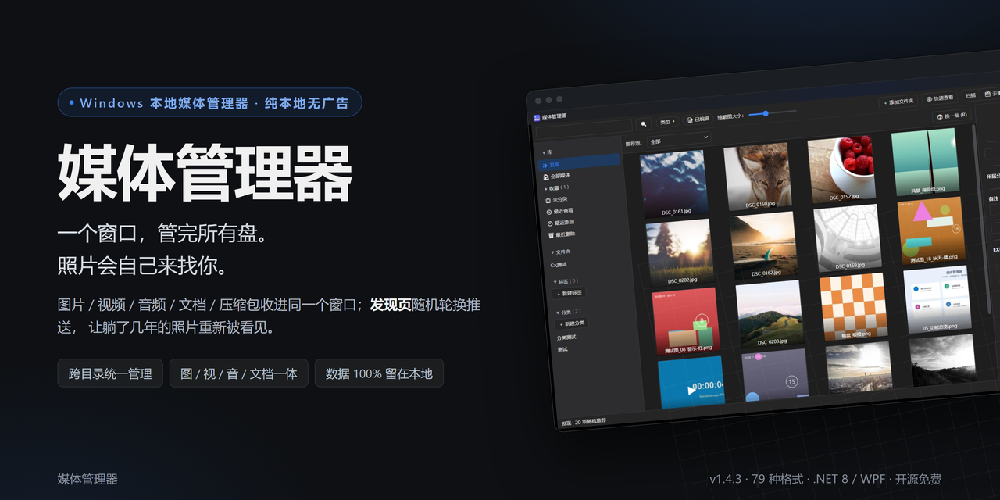

# 📸 MediaManager

> 免费、开源、纯本地无广告的 Windows 媒体管理器 —— **一个窗口，管完你的图片、视频、音频、文档和压缩包**。
> 把电脑和移动硬盘里散落各处的文件收进同一个库，数据始终在自己手里。

**[📥 下载最新版安装包](https://github.com/3206YYY/MediaManager/releases)** ｜ **[🌐 官网](https://3206yyy.github.io/MediaManager/)** ｜ **[🇨🇳 Gitee 源码镜像](https://gitee.com/yyy3206/MediaManager)** ｜ **[☕ 赞助开发者](#sponsor)** ｜ **[🐛 提交 Bug](https://github.com/3206YYY/MediaManager/issues)**

> 当前版本 **v1.4.2** · Windows 10 / 11 · 免装 .NET 运行库 · MIT 开源
>
> 🆕 **v1.4.2**：主列表查询加了复合索引，10 万条实测首页 **79ms → 0.4ms**、翻到第 5 万条 **2.4 秒 → 12ms**；新增可复跑的数据库基准与实机验收脚本；撤掉了此前没有依据的性能表述。详见 [更新说明](docs/changelog/v1.4.2.md)。

---

## 它最想解决的三件事

### 🗂 一个窗口，管完所有盘

C 盘、D 盘、移动硬盘里的图片、视频、音频、文档、压缩包，可以一起加进同一个库：
**一个搜索框、一次筛选、一次批量改名/导出 —— 再也不用开十几个资源管理器窗口来回对照。**

### 🎛 不止图片视频

图片和视频之外，**音频（mp3/flac/…）、文档（txt/md/…）、压缩包（zip/rar/7z/…）** 也能一起入库，
按类型多选筛选；**共支持 79 个常见扩展名**，双击即用系统里装好的专业软件打开。

### ✨ 让照片主动来找你

文件太多，谁都没动力一个个文件夹翻。
「发现」页会从你的库里**随机推送你还没细看的照片和视频** ——
它们不再只是躺在硬盘深处的一串文件名，而是会重新跳到你眼前。

| ☀️ 浅色模式 | 🌙 深色模式 |
|:---:|:---:|
|  |  |

---

## 🤖 开发者自白 (About the Developer)

本项目是由本人虔诚地向圣诞老人（AI）许愿得到。本人只参与了产品创意、UI 交互设计和测试，产品仍在快速迭代，欢迎提 Issue 指出问题。

*This project is co-developed with AI. Ideas, UI/UX design, and rigorous testing are done by a human; coding is done by AI.*

---

## ✨ 还有什么

- 🚀 **列表不卡**：虚拟化列表 + 后台多线程解码。10 万条元数据实测，主列表首页 **0.4 ms**、翻到第 5 万条 **12 ms**、按文件夹统计 **7 ms**（加索引前分别是 79 ms / 2.4 秒 / 1.05 秒）。数字由 [`build/bench_db.py`](build/bench_db.py) 生成，可自己复跑；它**只测 SQL 层**，不包含界面渲染和内存峰值，别当成整机体验。
- 💾 **纯本地无广告**：数据全在本地 SQLite，支持深色 / 浅色主题。拔出移动硬盘不崩溃，甚至能自动恢复盘符路径。
- 🔒 **私密空间**：按 `Ctrl+L` 开一个**独立窗口**（类似浏览器无痕窗口，功能一样齐），文件真正挪进隐藏目录，主网格、搜索、标签、分类、收藏统计、发现页全都查不到。**密码可选、由你自己决定**——顶栏有个「🔑 设置密码」，不点就一直是一层「藏起来」（挡身边人随手翻，不假装防取证），点了进门前就要输密码；忘记密码也不丢数据，文件没加密。里面还能**自建分区**、排序、收藏，东西再多也不乱。
- 📔 **日记**：左边日历右边回忆，一天可以写多篇、每条挂多个图片视频；有内容的日期带小圆点。只存在你自己的库里，没有任何联网。
- ✂️ **内置轻量编辑器**：拖拽裁剪、涂鸦、加文字、马赛克、滤镜。**编辑原图自动生成新副本，编辑副本则原地更新**，原图绝不会被偷偷改掉。
- 🎬 **视频播放像样**：内置 LibVLC，倍速、全屏、快捷键；播完可选**播完暂停 / 列表循环 / 单曲循环 / 随机播放**，选一次就记住。
- 🗑️ **后悔药**：误删直接进回收站并可一键撤销；收藏、分类、标签自动备份。
- 🕒 **时光机**：自动备份保留最近 7 个时间节点，列表里能看到每个节点的备份时间与大小，选一个就能把整个整理库退回去；恢复前会先存一份当前状态，坏节点一律拒绝。
- ⌨️ **快捷键顺手**：主界面单键就能干活（`R` 换一批、`F` 收藏、`1`~`5` 打星），**中文输入法下也照常生效**，不会弹候选框；全局热键可自定义（默认 `Ctrl+Alt+Shift+M` 唤起窗口）。
- 🎲 **不想挑就随机**：查看器按 `R` 随机跳一张，范围可选当前列表 / 当前文件夹 / 全部库 / 仅收藏。
- 🗂 **多格式扩展（共 79 个扩展名）**：图片、视频之外，**音频（mp3 等）、文档（txt/md 等）、压缩包（zip/rar/7z 等）** 也能一起入库、按类型筛选。双击时不另开半成品窗口，直接交给系统默认程序（你的 Foobar / VS Code / WinRAR），右键还有「用系统默认程序打开（Ctrl+O）」。可在 设置 → 插件扩展 里开关。
- 🧩 **可扩展**：官方没做的小功能，可以用插件接口自己加（见 [插件接口](docs/plugin-api.md)）。
- 📦 **极致轻量**：安装包仅 97MB，免装 .NET 运行库，傻瓜式一键安装。

---

## 📦 支持格式（共 79 个）

| 类型 | 数量 | 常见扩展名 |
|---|---|---|
| 图片 | 13 | `.jpg .jpeg .jpe .jfif .png .gif .webp .bmp .tif .tiff .ico .heic .avif` |
| 视频 | 17 | `.mp4 .mkv .avi .mov .wmv .webm .flv .m4v .ts .mpg .mpeg .3gp .mts .m2ts .ogv .rmvb .vob` |
| 音频 | 15 | `.mp3 .wav .flac .m4a .aac .ogg .opus .wma .aif .aiff .amr .mka .ape .mid .midi` |
| 文档 | 24 | `.txt .md .log .json .csv .xml .yaml .yml .htm .html .srt .ass .ssa .toml` + 代码 `.py .js .css .cs .java .go .rs .sql .bat .ps1` |
| 压缩包 | 10 | `.zip .rar .7z .tar .gz .bz2 .xz .tgz .tbz2 .txz` |

> 图片和视频用**内置查看器**（随机跳转、快捷键、编辑器只在这里）；音频、文档、压缩包双击交给**系统默认关联程序**，不自带播放器 / 阅读器。
> 完整行为见 [v1.4.2 更新说明](docs/changelog/v1.4.2.md)。

---

## 📥 下载与安装

1. 前往 **[Releases](https://github.com/3206YYY/MediaManager/releases)** 页面，下载最新版的 `MediaManager-Setup-x.x.x.exe` 安装包（用户级安装，无需管理员权限）。
2. 双击安装后启动，点击主界面的「添加文件夹」选择你的媒体目录。
3. 程序会在后台自动扫描并生成缩略图，立马就能使用！

> 🇨🇳 **GitHub 打不开？** 源码在国内镜像 **[gitee.com/yyy3206/MediaManager](https://gitee.com/yyy3206/MediaManager)** 也有一份（手动同步，可能滞后一版，**以 GitHub 为准**）。
> **安装包主源是 GitHub Release**（约 97 MB）；Gitee 镜像以源码为主，可能滞后一版。
> 下载慢就隔几分钟重试，或者提个 issue 说明情况。GitHub 是主仓库，issue / PR 请提到这边。

> ✅ **安装包已内置全部依赖**：.NET 运行时、**FFmpeg**（视频缩略图）、LibVLC（视频播放）。
> 双击即用，**不需要额外安装任何东西，也不需要联网**。装完就能看视频封面、播视频、编辑图片。

> 🔄 **更新**：设置 → 关于与更新 → 「检查更新」，会告诉你有没有新版本，并可一键跳去下载。
> 该检查走的是 GitHub API，**GitHub 不可达时会提示失败**，此时到 Releases 页面手动下载即可（需要能打开 GitHub）。

---

## 🧩 插件

主程序只做「大多数人都要」的功能。剩下那些小众玩法（导出特定格式、接自己的脚本、批量处理某个奇怪需求），交给插件：

- 插件放在 **`{数据目录}\plugins`**，设置页「插件扩展」里可直接打开目录、重新扫描。
- 插件只拿到「当前选中的文件」+ 一个注册菜单的接口，**碰不到主程序内部** —— 插件崩了不会拖垮软件，主程序升级也不会把插件全废掉。
- 模板：**[docs/plugin-template](docs/plugin-template)**（40 行就能跑起来）；接口说明：**[docs/plugin-api.md](docs/plugin-api.md)**。

---

## 🛠️ 技术栈与架构

本项目基于 **C# .NET 8 + WPF + MVVM** 构建。

| 组件 | 用途 |
|------|------|
| .NET 8 + WPF | 应用框架 |
| CommunityToolkit.Mvvm | MVVM |
| Microsoft.Extensions.Hosting / DI | 依赖注入 |
| Microsoft.Data.Sqlite + Dapper | 数据库（**不用 EF Core**） |
| SixLabors.ImageSharp | 图片缩略图与编辑 |
| MetadataExtractor | EXIF 读取 |
| LibVLCSharp.WPF | 视频播放 |
| FFmpeg | 视频抽帧 / 特殊格式解码 |
| Serilog | 文件日志 |
| VirtualizingWrapPanel | 缩略图虚拟化 |
| Inno Setup | 打包 |

**项目结构：**

```
MediaManager.sln
├─ src/MediaManager.App/               WPF UI（主窗口 / 图片查看器+编辑器 / 视频播放器 / 私密空间 / 日记 / 设置 / 插件宿主）
├─ src/MediaManager.Core/              领域模型、接口、纯逻辑（编辑/媒体/插件契约）
├─ src/MediaManager.Infrastructure/    SQLite、文件系统、缩略图、便携模式
├─ tests/MediaManager.Tests/           Core / Infrastructure 单元测试（260 项）
├─ tests/MediaManager.App.Tests/       App 层单元测试（6 项，net8.0-windows）
├─ docs/plugin-template/               插件模板（可编译的最小示例）
├─ tools/ffmpeg/                       ffmpeg.exe（不进仓库；Release 安装包已内置）
└─ build/installer.iss                 Inno Setup 安装脚本
```

---

## 💻 从源码构建 (Build from Source)

> 需要 **.NET 8 SDK**。若 `dotnet` 不在 PATH，请用完整路径（例如 `C:\Users\<你>\.dotnet\dotnet.exe`）。

```bash
# 还原 + 编译
dotnet build MediaManager.sln

# 运行测试
dotnet test MediaManager.sln

# 发布（本地运行）
dotnet publish src/MediaManager.App -c Release -r win-x64 --self-contained false
```

> 🎬 **FFmpeg 说明（只与源码构建者有关）**
>
> 官方 Release 安装包**已经内置** `tools/ffmpeg/ffmpeg.exe`，普通用户不用管。
>
> 自己从源码运行的话：视频缩略图需要 FFmpeg，而 `tools/ffmpeg/` 目录**不进 Git 仓库**（单个 exe 约 100MB）。
> 请从 [gyan.dev](https://www.gyan.dev/ffmpeg/builds/) 下载 `ffmpeg-release-essentials`，解压出 `bin/ffmpeg.exe`
> 放到 `tools/ffmpeg/` 下；也可以启动后在软件「设置 → 媒体与性能 → FFmpeg 路径」里手动指定。
> 没有它程序照样能跑，只是视频格子不生成封面（显示占位图标），图片功能完全不受影响。

---

## ⌨️ 常用快捷键

| 按键 | 功能 |
|------|------|
| Space / Enter | 快速预览 / 打开查看器 |
| ← / → | 查看器内切换上一张 / 下一张；视频内快退 / 快进 5 秒 |
| Delete / Shift+Delete | 删除到回收站 / 永久删除 |
| R | 主界面：换一批推荐 ／ 查看器：随机跳转（右键可改范围） |
| F | 收藏 |
| 1 ~ 5 | 打星（1~5 星） |
| F2 | 重命名 |
| Ctrl+F | 聚焦搜索 |
| Ctrl+L | 开 / 关私密空间窗口 |
| Ctrl+O | 用系统默认程序打开当前文件 |
| Ctrl+Enter | 打开所在文件夹 |
| Ctrl+Alt+Shift+M | 全局热键：显示 / 隐藏主窗口（设置 → 快捷键 可改） |
| Esc | 退出查看器 / 退出全屏 |

> 单键快捷键在**中文输入法下同样有效**（窗口不启用 IME，只给搜索框和备注框单独打开），不会弹出候选框。
> 视频播放器内还支持：空格播放 / 暂停、↑ / ↓ 音量 ±5%、M 静音、F 或双击画面切全屏。
> 查看器内：鼠标移到画面左右边缘呼出翻页箭头，滚轮可缩到 15%，双击画面回到「适应窗口」；按住 `\` 看原图。

---

<a name="sponsor"></a>

## ☕ 赞助与支持 (Support the Developer)

本软件完全免费、无广告且遵循 MIT 开源协议。如果你觉得这个软件帮你解决了痛点，或者单纯想支持一下大学生的开源梦想，欢迎请我喝杯咖啡！

👉 **[点击这里前往爱发电支持我](https://afdian.com/a/3206YYY)**

您的赞助将用于：升级维护该软件，以及作者其他软件的开发。

---

## 📄 License

本项目采用 **MIT 协议**开源。你可以自由使用、修改甚至商用，但请保留原作者信息。

Copyright © 2026 MediaManager
